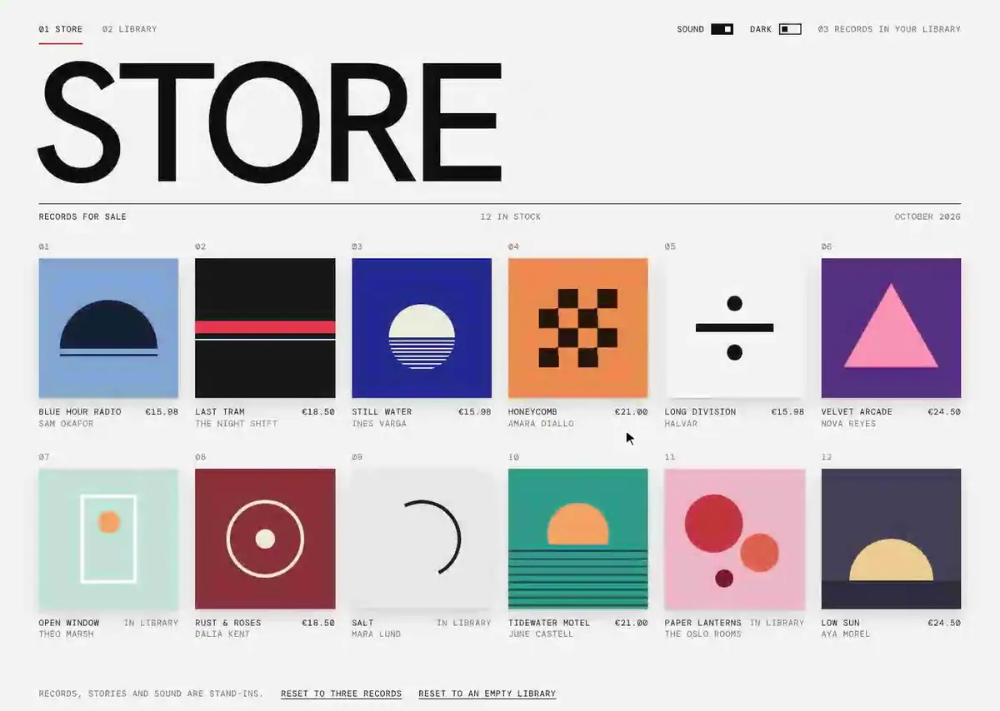

# Record store interaction

A record store and a turntable for listening to music on purpose. Browse the store, read why a record exists, hold to buy it, then take it off your shelf, drag the vinyl onto the turntable, and read the story of the song, the record and the artist while it plays. A switch in the top bar moves between light and dark.

<p align="center">
  
</p>

<p align="center"><a href="docs/demo.mp4">Watch as a video</a></p>

## Tech stack

- React 19
- Vite 8
- Tailwind CSS 4
- CSS transitions and keyframes, no animation library
- Web Audio API for the generated stand-in sound
- Cover art and turntable drawn in CSS, icons as inline SVG

## Run

```bash
npm install
npm run dev
```
